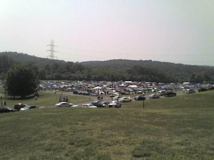
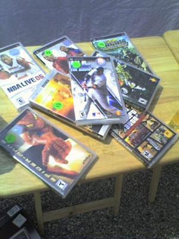
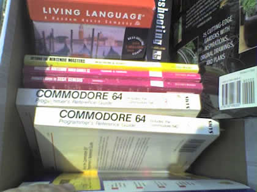
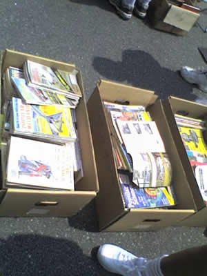
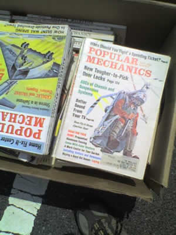
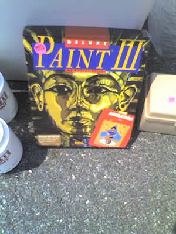
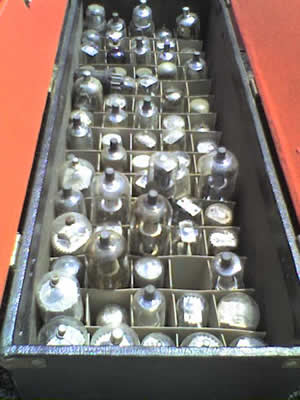
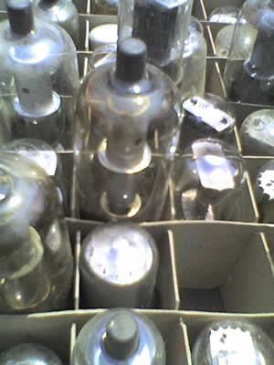

I took some photos during the garage sale on the campus of CCM, the County College of Morris. Basically, anyone who wants to participate can sell their unwanted stuff with hundreds of other people. Fortunately for me, I found lots of cool and interesting stuff to show you all:

 Here's a shot of the event itself...

 PSP Games!?!?!?!?!

 ...For how much!?!?!?!!

 Look at all the computer books!

 Here's some you might remember from the '80s

 Some old Popular Mechanics magazines, dating from
the '50s, if I can remember correctly

 A close up shot of a Popular Mechanics magazine

 Wow! Deluxe Paint 3 for the Amiga!

 Lots of vacuum tubes

 A close up shot of a vacuum tube