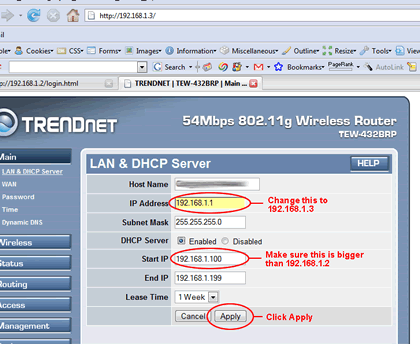
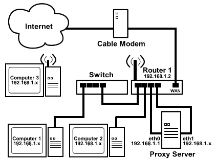
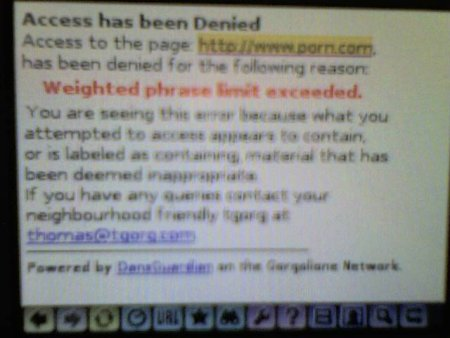
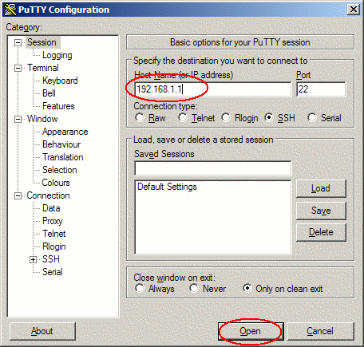

Wanted an cheaper alternative to filtering programs such as CyberPatrol and NetNanny using open source software?  This is a step by step how-to on setting up a content filtering server on the cheap, in a wireless network that will allow a Nintendo DS to connect without any issues.

**Note:** This guide is based on a culmination of many other guides and information found on the internet:

* <http://ubuntuforums.org/showthread.php?t=320733&highlight=squid+dansguardian>
* <http://www.webservertalk.com/archive254-2006-4-1470138.html>
* <http://ubuntuguide.org/wiki/Ubuntu:Feisty#SSH_Server>
* [http://dansguardian.org/?page=requirements](http://ubuntuguide.org/wiki/Ubuntu:Feisty#SSH_Server)

## Introduction

***Or, Why in the world am I doing this?***

Back in the early days of the Internet, things were simple. Universities exchanged information happily without worry about what they were looking at, because all they were looking at was scientific data, or the occasional chain email or two...

Flash forward 30 years.  The Internet had quickly grown from it's humble beginnings to achieve mass media heights as high as movies and television.  And along with TV and movies, the Internet has become a place that had it's good sides, as well as it's bad sides.

Personally, I'd like to avoid at all costs these "bad sides".  And so awhile back I began thinking about how to do this.  Getting client-based software for all of the computers in my household is costly considering initial costs plus a yearly subscription, and there isn't any real good free alternatives.  So I figured I'd take an old computer I had lying around and turn it into a Linux-based content filtering/proxy server, with ssh for administrative purposes.

The idea was novel, but I soon realized that my first attempt prevented my Nintendo DS from accessing the Internet.  Bummer.  So I redid the network and set up the proxy so even the NDS can use it.   And this is how I did it:

## Prerequisites

You should be proficient in installing operating systems, and have some experience in both the Command Line in Windows and the shell in Linux, have some experience setting up a home network, and have a willingness to muddle through and try new things.  Knowing about BIOS and POST is important too.

## What you need

* **A computer.**  Could be anything, as long as it'll run Ubuntu Linux (command line only), ssh, DansGuardian, and Squid.  DansGuradian's website suggests around 150mhz, greater than 4GB of hard disk space and greater than 64MB of RAM for 50 users.  You must also have 2 LAN cards installed.For my setup, I use a 300MHz AMD K6-2 computer, with 4GB of hard drive space and, if I remember correctly, 256MB of RAM.

* **Monitor and Keyboard** needed for initial setup, but after we get it going, you can optionally unplug them.

* **Either a router (wireless or otherwise) with lots of ports, or a router and a switch.**  The server will take two ports on the router, so you may need an additional switch for extra ports.  I've only tried this configuration with a wireless router, so your mileage may vary

* **Cable or DSL Modem of some sort.**  I have a cable modem, but a DSL modem should work as well.  Your mileage may vary.

* **A copy of the Ubuntu 7.04 Alternate Install CD**

## Proceeduere

***Or, "Let's get this train wreck-a-rollin' !"***

1. **Configure the Router.** Go into the wireless router setup by connecting a free computer (not the server your setting up) to the router by Ethernet cable, and by typing the IP of the browser (normally 192.168.1.1) in the address bar of your favorite browser.Log in with a your username/password, or, if you never configured your username and password for the router, use the usual admin/admin username/password combination.First change the IP address to 192.168.1.2.  The reason for this is because we'll need 192.168.1.1 reserved for the server.Second, look for an option to change the range of addresses that the DHCP server is issuing from.  Make sure that the range begins with an IP larger than 192.168.1.3.  It should be ok with the default setting, but you can never be too careful.
   [](screen1big.gif)

2. **Connect everything together.**
You might be wondering, *why do I need to set everything up this way*?  Take a look at this (click on the image for a bigger view):
   [](chart1big.png)It's quite a monster, but you'll understand my reasonings after I explain.  I could have put the proxy in between the internet connection and one of the routers, but all computers would *have* to use the proxy server.  The problem with that is, the Nintendo DS doesn't have any settings for proxy within it's wireless configuration setup, preventing any hope of it to work under that configuration.  Instead I created a system where an unfiltered internet connection is accessible for the DS (and all the computers for that matter), but once the browsers are configured to use the proxy, all computers will be using a filtered connection.  I have a  "loop" of sorts within the proxy allowing this to work; eth0, one of the Ethernet cards, are configured for computers on the network to connect to the proxy server, and has the IP of 192.168.1.1, while eth1, the other Ethernet card, is used to get the internet connection, and has a variable IP address that comes from the DHCP server in the router.

   Now set up the network as shown.  Use "patch" cat 5 Ethernet cable to connect the network as shown on the diagram.  If you are using only one router, you can connect the computers as if the two routers were one, but ignore the connection between routers.

4. **Install Ubuntu onto the Proxy Computer.** *Note: Make sure your BIOS settings are set to boot from CD-ROM first by going into BIOS setup and changing the boot order.* Turn on the computer and insert the Ubuntu Alternative CD into the CD-ROM drive before it boots into the OS.In the boot menu that appears, select the "Install a Command line System" option, and follow the instructions on screen.  You will see a network adapter selection screen shown when you are configuring networking.  Make sure **eth0** is set as the primary adapter

5. **Modify the network interfaces file in /etc/network/interfaces** After you've completely installed command line Ubuntu, you'll need to edit the network settings.  Reboot the computer and once Ubuntu is loaded, login as root.Type in the following commands to open the configuration file using nano:

   ```
   cd /etc/network
   sudo nano interface
   ```

   **nano** is a popular text editor in Linux.  Edit the file to look like this:

   ```
   auto eth0
   iface eth0 inet dhcp

   auto eth1
   iface eth1 inet static
      address 192.168.1.1
      netmask 255.255.255.0
   ```

   When done, hit Ctrl-O to save and Ctrl-X to exit nano.  Now, you'll want to test to see if the proxy server's Ethernet adapters are configured properly.  Restart the server's network  by typing in the following command:

   ```
   sudo /etc/init.d/networking restart
   ```

   Now, try to ping to the proxy server.  Use a different computer on the network to do this:

   From a Windows Computer:

   Go to *Start* > *Programs* (or *All Programs* in XP/Vista) > *Accessories* > *Command Prompt*
   Type the following in the Command Prompt:

   ```
   ping 192.168.1.1
   ```

   See if there is any reply messages.  If you don't get any reply, then there's something wrong with the configuration.
   From a Linux Computer:
   
   If you are running under an X window manager such as GNOME or KDE, open up a terminal (in Ubuntu it's under *Applications* > *Accessories* > *Terminal*).
   Type the following:

   ```
   ping 192.168.1.1
   ```

   See if there is any reply messages.  If you don't get any reply, then there's something wrong with the configuration.

6. **Install SSH.** SSH enables you to connect to the proxy server's command line using another computer over the network.  It's great when you don't want to use a KVM switch.Go back to the content filtering server.  To install ssh, use the following command:

   ```
   sudo apt-get install ssh
   ```

7. **Install Squid.** Now we'll install squid. To do this, type the following command in:

   ```
   sudo aptitude install squid
   ```

   You may get an error message "FATAL: Could not determine fully qualified hostname"
   That's okay, we will fix that in the next step.

8. **Configure Squid**
   Type in the following commands to open Squid's configuration file using nano:

   ```
   cd /etc/squid

   sudo nano squid.conf
   ```

   You will be confronted with a \*huge\* configuration file.  Take a deep breath...
   You'll see a line that looks like this:

   ```
   # acl our_networks src 192.168.1.0/24 192.168.2.0/24
   ```

   **Note:** if you need to, you can search for the line by pressing Ctrl-W
   Make it look like this:

   ```
   acl our_networks src 192.168.1.0/24
   ```

   Search for visible\_hostname by pressing Ctrl-W, typing in "visable\_hostname" and pressing Enter
   You come to a section that talks about what the visible\_hostname does, etc.
   Goto the bottom of that description, below the following two lines:

   ```
   # Default:

   # none
   ```

   And make it look like this:

   ```
   # Default:

   # none

   visible_hostname localhost
   ```

   Save the file by pressing Ctrl-O and exit by pressing Ctrl-X

9. **Install Dansguardian.** Type the following command and press enter

   ```
   sudo aptitude install dansguardian
   ```

   You will get an error saying that DansGuardian "has not been configured".   As before, we'll that in the next step.

10. **Configure** **DansGuardian.** Type the following commands to open a DansGuardian configuration file using nano:

    ```
    cd /etc/dansguardian

    sudo nano dansguardian.conf
    ```

    Another configuration file will pop up (geez this is getting a bit monotonus!)
    Change the following line:

    ```
    UNCONFIGURED - Please remove this line after configuration
    ```

    To this...

    ```
    # UNCONFIGURED - Please remove this line after configuration
    ```

    And save the file by pressing Ctrl-O and exit by pressing Ctrl-X.
    Type the following command to open another DansGuardian configuration file and press enter

    ```
    sudo nano dansguardianf1.conf
    ```

    Depending on who you are and what kind of family you have, you may want to adjust the threshold Dansguardian uses to block sites.  At default, DansGuardian sets the threshold at a level where kids can browse the internet safely.  I'm a college student, and there's no kids in my household, so I will change the threshold.
    The line in the configuration file is this:

    ```
    naughtynesslimit = 50
    ```

    And I set it to this:

    ```
    naughtynesslimit = 160
    ```

    Above this line are instructions on what level to use.  The author of DansGuardian recommends 50 as a limit for kids, while 160 is suggested for people my age.
    Save the file by pressing Ctrl-O and exit by pressing Ctrl-X
    Restart DansGuardian and Squid by typing in the following commands:

    ```
    sudo /etc/init.d/squid restart

    sudo /etc/init.d/dansguardian restart
    ```

    **Optional:** The Ubuntu DansGuardian package comes preconfigured to virus scan all files that are downloaded using the proxy server.  I've noticed that this can break some updates done by antiviruses (e.g. Norton) and other similar programs, especially if they use IE's internet settings automaticially.  If you have antivirus software installed on the computers that are connected to the internet, it is safe to turn this setting off.
    To disable the virus scan, look for the following line:

    ```
    virusscan = on
    ```

    And change it to this:

    ```
    virusscan = off
    ```

    Make sure you restart Squid and DansGuardian when you're done (see above).

11. **[OPTIONAL] - Turn off keyboard error in BIOS.** To run the server without the keyboard, you'll need to change the BIOS to prevent POST from stopping on keyboard errors.  The instructions on this are outside the scope of this how-to.

12. **Configure all computers on the network.** All of the computers should still be able to access the Internet without any additional configuration, but the connection will not be filtered. To make your Internet browser use the content filtering server, you will need to do the following on every computer that's on the network:

    - If you use Internet Explorer to access the Internet:

      In Internet Explorer, go to Tools > Internet Options.In the resulting window, click on the Connections Tab.  Click on the LAN settings button.In the LAN settings window, check the "Use a proxy server for your LAN" box, and in the address box, type in the IP address of the content filtering server, 192.168.1.1, and set the port to 8080.

      Click on the Advanced button.  In the new window, check the "Use the same proxy server for all protocols" box, and click OK.

       Click OK in the LAN settings window.

      Click OK in the Internet Options window.

      You may need to restart Internet Explorer for the changes to take effect.

    - If you use Firefox to access the Internet:

      In Firefox, go to Tools > Options...
    
      In the resulting window, go to the Advanced section,  click on the Network tab, and click on settings.
    
      In the new window, make sure that "Manual Proxy configuration" is set, and in the HTTP Proxy box, type in the IP address of the content filtering server, 192.168.1.1, and set the port to 8080.
    
      Check the "Use this proxy server for all protocols" box, and click OK.
    
      Click OK in the Options box.
    
    - Using the Nintendo DS:
    
      After the wireless internet settings are set up, you can configure the Nintendo DS Browser to access the proxy server.
    
      Go into the browser settings section (indicated by a wrench icon), and tap the "Proxy Settings" button.
    
      Type in the 192.168.1.1 IP address in the Proxy box, 8080 in the Port box, and check the "Use Proxy" box and tap the Ok (or check) button.
    
      If you want to test it, you can go to www.porn.com.  You'll see a page like this if it works:
    
      
    
      **Note:** I changed the error page to my setup, so yours may look a little different...

## Accessing the server using SSH

Once you're done setting everything up, you can disconnect your monitor and keyboard from the server.   "But", you ask, "how am I going to make changes on the server?".  Since we installed ssh, we can use a terminal program to access the server from another computer on the network:

1. **Download PuTTY.** PuTTY is a really good open-source terminal program.  You can get it at <http://www.chiark.greenend.org.uk/~sgtatham/putty/download.html>

2. **Run** **PuTTY.** Double click on the program to run it.  In the resulting box, place the IP address of the proxy server into the *Host Name* box, and click on the *Open* button.
   
   A new window will open.  When asked for a username and password to login, use the username you provided when you installed Ubuntu into the proxy server. You can now use PuTTY as if you were using the command line in Linux.

That's it!  There's a lot more things you can do in terms of customizing your server, but the basic setup is done and is fully operational.